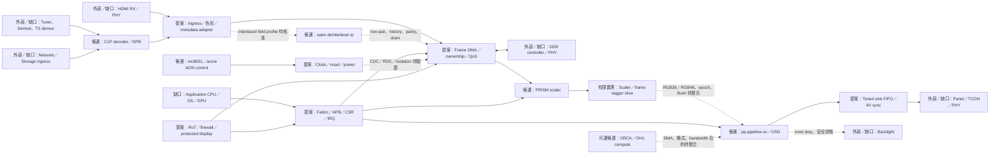
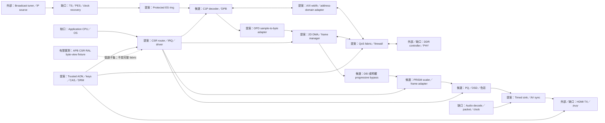
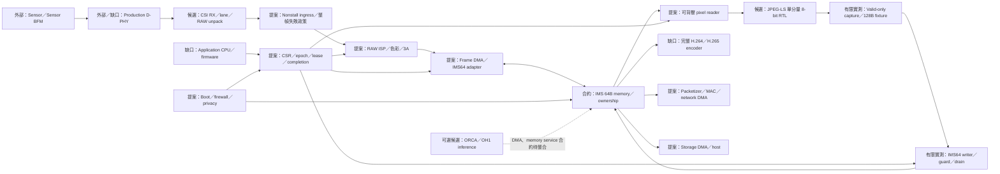

# TV／STB／IPCAM SoC 架構圖

證據快照：2026-11-06。狀態：**整合提案／完整 SoC 尚未驗證**。

本文件供 IP owner 對齊產品資料路徑、控制責任與驗證邊界。圖中箭頭表示預期 transaction 關係，不是已完成 RTL 接線；實線也不代表時序、位寬或吞吐量已通過驗證。產品 IP 表是候選能力盤點，SKU、地址／IRQ、clock/reset/power、PHY 與服務上界尚未凍結。

**圖例：**「候選」為已盤點來源；「提案」為待整合責任；「外部／缺口」為尚未取得產品資格的依賴；「有限實測」只適用下述固定來源與測試組態。圖中控制 MCU／OH1 選項不能直接充當已驗證 Linux application CPU。

## TV：顯示與畫質路徑

PRISM 是行處理來源；有限 scaler/tagger smoke 不代表完整 2D／anti-alias、PQ、panel pacing 或 4K/8K 服務保證。DEI 的固定延遲 cache／row-pair 介面不能直接視為可背壓 AXI stream。HDMI TX demo 不能替代 HDMI RX 或正式 PHY。

## STB：解碼、記憶體與輸出路徑

APB RAL fixture 驗證 CSR frontdoor、byte enables、IRQ/W1C 與 reset 子集；不能替代主動 AXI memory、完整 codec RAL、跨 IP CRV 或全系統連通性。Progressive bypass 必須是明確組態，不能當作 DEI 整合已通過。

## IPCAM：擷取、影像與編碼路徑

Sensor 可能不能停送，不能將 pixel-reader 的 ready 回推到 sensor。JPEG-LS 輸出為 valid-only，capture 必須逐 byte 接受；128B fixture 不是無界緩衝。成功 completion 必須在有效資料、ownership、error 與 memory drain 條件全滿足後產生；外部已接受寫入不會因 abort 自動回滾。

## 跨 IP 接線前必須核對

| 邊界 | 必須固定的合約 | 目前缺口 |
|---|---|---|
| Media stream | payload 位寬、packing、SOF/EOL/field、accepted beat、backpressure | MVS 候選 16B beat 與 IMS 64B line 不可直接接線；interlaced profile 待審 |
| Frame／memory | 地址單位、alignment、burst、ordering、outstanding、service 上界 | DDR／DMA／cache adapter、ownership、容量與 QoS 待整合 |
| Recovery | epoch／lease、reset、abort、quarantine、drain、error／done | 逐邊界定義 stale response 與有限服務前提；不能靠 stub 宣告完成 |
| Control | approved CSR／IRQ、W1C、side effects、register reset、driver ABI | 產品地址與 IRQ 尚未凍結；leaf target 不等於 application host |
| Clock／power | domains、CDC/RDC、clock gating、isolation、retention | 完整實作與時序／physical 證據不足 |
| Security／external | boot chain、keys、firewall、CAS/DRM、sensor／display／memory PHY | 各產品需獨立來源、授權與資格證據 |

## 驗證與證據範圍

| 產品／來源 | 已有有限證據 | 尚未關閉 |
|---|---|---|
| TV，PRISM [PR #2](https://github.com/tonythetiger168/prism-video-scaler/pull/2) | 舊固定版本 minimum no-DPI scaler/tagger smoke 正負向紀錄；有限 functional map 175/175 | 新 head `8c2453ce` class CRV runtime 未跑；完整 TV RTL／六類 coverage 未關閉 |
| STB，protocol [PR #29](https://github.com/tonythetiger168/open-ip-portfolio/pull/29) | 本地 RAL byte-view fixture 14/14 檢查、22 APB／14 reads／8 writes、PSTRB F/1/2/4/8；正向零 ERROR/FATAL，負向拒絕 | 本地修復 package SHA256 `fe36745af099101dbb8a011e9b1307b1e968ff8440c33ddbdd97d63709f037ee` 尚未由該 PR 原 CI 驗證；不是全 STB SoC |
| IPCAM，IMS [PR #6](https://github.com/tonythetiger168/xuanji-ims/pull/6) | 最後已核實 v2 functional 76/2903，原 243 OPEN；JPEG-LS→capture→IMS64 有限子集 | 新 head `3e8eadb8` 候選 campaign 未跑；35 tuples 僅模型預測 |
| Codec [run 41964241919](https://github.com/tonythetiger168/c1p-codec/actions/runs/41964241919) | 部分 artifacts：HEVC 90 vector PASS logs、UVM 25 完成 PASS logs | 整體 cancelled；2 empty logs／17 missing；native coverage 分母不足，取消原因未知 |
| Codec [run 42183559794](https://github.com/tonythetiger168/c1p-codec/actions/runs/42183559794) | head `9860c395`，工具／HEVC jobs 成功 | UVM PCH 編譯因磁碟耗盡失敗，runtime 未跑；修復審查中 |

所有完整 SoC 的 line、FSM states **及** arcs、toggle 0→1 **及** 1→0、branch、非 vacuous SVA、functional coverage 都需分開提供 hit/total/exclusions。完整分母未取得或未實跑時標 **NOT_RUN／BLOCKED**，零排除；不由有限 map 100%、README、job 名稱或另一版本 CI 推論全系統 100%。Physical／STA／PPA／PHY 另設驗收。

驗證順序：固定 top/hierarchy/filelist/source pins → clock/reset/address/IRQ/contracts → 真實 RTL elaboration 與最小端到端比對 → IP/adapter conformance → 多 IP CRV → 逐組態六 metric closure。獨立 monitor／oracle／scoreboard、seed replay、negative/mutation、raw logs/DB 與 failure replay 都需保留。

## Repo 分工索引

| Repo | 產品責任 |
|---|---|
| [xuanji-core](https://github.com/tonythetiger168/xuanji-core) | 三產品總計畫、共用平台／系統整合、契約與缺口追蹤 |
| [xuanji-ims](https://github.com/tonythetiger168/xuanji-ims) | IPCAM imaging、IMS64、capture／ownership／guard 邊界 |
| [c1p-codec](https://github.com/tonythetiger168/c1p-codec) | TV/STB decoder 與候選 codec／MCU；encoder 能力逐 profile 核實 |
| [prism-video-scaler](https://github.com/tonythetiger168/prism-video-scaler) | TV/STB scaler、frame metadata 與 display adapter |
| [open-deinterlacer-ip](https://github.com/tonythetiger168/open-deinterlacer-ip) | TV/STB interlaced field／history／row-pair 邊界 |
| [pq-pipeline-sv](https://github.com/tonythetiger168/pq-pipeline-sv) | TV/STB PQ，IPCAM 可選影像後處理；格式／epoch／背壓待審 |
| [jpeg-ls-codec](https://github.com/tonythetiger168/jpeg-ls-codec) | IPCAM JPEG-LS valid-only egress、capture／memory writer 合約 |
| [open-ip-portfolio](https://github.com/tonythetiger168/open-ip-portfolio) | 三產品 bus／CSR／protocol／security leaf 候選；不是已整合 fabric |
| [open-vip-portfolio](https://github.com/tonythetiger168/open-vip-portfolio) | Bus／memory／stream VIP、monitor、negative stimulus；VIP 不當產品 RTL |
| [acme_soc](https://github.com/tonythetiger168/acme_soc) | 三產品 AON／MCU／控制周邊候選 |
| [mc8051-core](https://github.com/tonythetiger168/mc8051-core) | AON／安全控制 MCU 候選；非 application CPU 替代品 |
| [orca-ai-accelerators](https://github.com/tonythetiger168/orca-ai-accelerators) | TV/IPCAM 可選 AI 路徑；DMA／DDR／服務條件待整合 |
| [openhelix-oh1](https://github.com/tonythetiger168/openhelix-oh1) | 可選 compute／control 候選；實際產品選用與互接仍待審 |

來源：產品 owner 維護的 TV-IP-table、STB-IP-table、IPCAM-IP-table 與三份 integration proposal；中央[總計畫](https://github.com/tonythetiger168/xuanji-core/blob/main/docs/TV_STB_IPCAM_IMPROVEMENT_PLAN_2026-10-26.md)。本圖不修改 IMS interface 或任何既有 ABI。舊名 orca-v63 對應 canonical xuanji-core。

## 本 repo 的 review 重點：open-ip-portfolio

請逐 leaf 固定 host/target 角色、CSR byte enables、AXI ordering/response、IRQ/W1C；不把 target wrapper 當 application host。

本文件由中央產品圖同步；審查結果請在本 repo 的 progress 文件留下版本、測試組態、證據與 OPEN 項目。文件合併不代表 RTL 或 coverage signoff。
