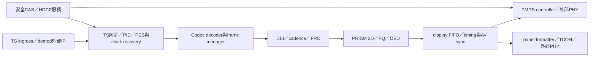

# HDMI／panel／broadcast 顯示整合 v0.1

日期：2026-10-26（Asia/Taipei）。成熟度：本新增項為 **design**；未新增 RTL、未重跑既有 verified、未進行 physical／合成／STA／板測。數字為明示假設的設計估算，並非 PPA 或吞吐實測。

## 基線與產品邊界
來源main 5480c40221b8c2a5e57c6228122fd1de8d3f9c3e；已讀同名改善計畫、docs/ip/HDMI_2_1.md及rtl/HDMI_2_1_top.sv。遞迴tree未發現AGENTS.md／CLAUDE.md；盤點時無open PR。檔名HDMI_2_1不能作為完整HDMI 2.1能力宣告。
現有640×480 internal pattern TMDS demo可重用encoder、control code、TERC4與packet測試；無外部pixel stream、無可配置timing，serialization為每pixel 10個clk的邏輯模型，非量產高速PHY。2026-10-26舊文檔前段曾稱BCH XOR簡化；2026-11-01已同步為固定AVI/SPD的BCH常數；新設計應以獨立packet oracle檢查，不宣稱動態packet ECC已完整。
既有文件列core line75/75、toggle466/466、SVA8/8、functional39/39及wrapper20/20、416/416、7/7、25/25；均為原demo歷史證據，本輪未重跑，不能延伸為PHY／HDCP／FRL／RX或產品認證。原generated文件／wrapper不在本PR改動，避免後續生成覆蓋。

## 2026-11-01 main 核對
最新main df9d0ed755c80d40aa42c4de55d6fd163c105c90。HDMI文件新增完整wrapper pins／programming sequence／執行步驟；core functional coverage目前記39/39（原16/16已過時），其餘列值依本文件基線。Makefile的syn/apb新增mkdir -p work，保留fresh-clone修正；不重做generator或全portfolio回歸。
現有HDMI核心仍無external video stream，沒有可配置timing／DDC EDID／audio／量產PHY；上述產品邊界不因coverage擴大而改變。本輪只審計源碼／文件，未重跑Icarus／Verilator／Yosys。新byte profile reference已在總repo檢查，但不等同HDMI sink實作。

## 系統分工與方塊圖

portfolio只擁有protocol controller／timing adapter及產品化規格；PRISM擁有scale/PQ/compositor；Codec解析壓縮video；平台擁有DMA／buffers／QoS／clock manager，security擁有key／CAS／protected routing。broadcast詳細產品規格本PR只定integration boundary，無新增demod或CAS實作主張。

## 外部video與timed sink
接平台AXIS raster RGB12 profile：4lane、SOF/EOL／valid lane顯式sideband，或byte-aligned RGB16 container adapter；具體packing與TUSER分配見總repo提案，G1前不宣稱既有core即相容。config descriptor含frame_id、timestamp64/timebase、format/color、active width/height、epoch/domain。
timing engine自動產生active/front porch/sync/back porch、polarity與total counters；counter width由CAP範圍定義，不沿用10-bit x/y截斷。stream only承載active pixels，blanking由sink產生，禁止將上游stall直接停pixel clock。FIFO在行前達到watermark才啟動；持續source不足時整行black並sticky underflow、frame poisoned，下一SOF重新鎖定。不能靠任意有限FIFO承諾無界DDR stall；watermark B≥pixel_bytes*pixel_rate*worst_stall＋burst安全量，容量與prefill latency由平台worst latency確認。
HDMI timing與AVI/color metadata同epoch在frame邊界切換；pixel clock或PHY mode變更需mute→drain→disable→PLL重新配置／lock→timing reset→合法blanking→unmute，不允許只換CSR立即送出。HPD同步／debounce，掉線立即mute並停止新descriptor，釋放引用後才重訓練。

## HDMI TX分階段
1. demo維持原測試；新增external-source與parameter timing wrapper，先RGB888 TMDS，不用模組名稱宣告FRL。
2. DDC開漏I2C／EDID讀取：timeout、NACK、checksum／extension長度上限、HPD變化取消交易，解析後與本地CAP取交集，不信任sink輸入長度。CEC為獨立低速open-drain controller／pin，初版可CAP=0。
3. 動態AVI/SPD及音訊packet、ACR/N/CTS、packet budget與獨立ECC reference；audio sample clock經async FIFO，AV sync以timestamp對齊，測clock drift／mute／underflow。HDR metadata僅在對應PQ與sink capability齊備時啟用。
4. PHY contract以每pixel三個10-bit TMDS symbol＋clock/control、pll_lock、tx_enable、fault為邊界；真實serializer、PLL、IO電氣與board constraints由外部PHY／FPGA primitive提供。需對目標mode計算pixel rate與10×TMDS串列bit rate，deep-color／420／scrambling等未實作不得宣稱。
FRL controller/training／FEC／PHY、HDMI RX、HDCP版本／金鑰佈署／認證各自build/license/external決策，初版CAP=0；不可將行為PHY或Apache授權代替商業授權／產品測試。

## Panel路徑
初版平行RGB＋DE/HS/VS timing與外部bridge contract，之後才評估LVDS／eDP／V-by-One等實際需求。TCON負責mapping、lane/pixel order、polarity、panel enable/backlight順序與故障blanking；overdrive/local dimming獨立列後續功能。
panel descriptor要求active/total/timing、bpc、color mapping、pixel clock、power/reset/backlight min delays，由板級資料提供具體值；未有panel規格不填通用魔術數值。power sequence OFF→rails stable→reset release→link stable→video stable→backlight，關機反序；fault先關backlight。外部電源控制經AON握手，不能在media power-off後失去關閉能力。

## Broadcast／TS／CAS整合
輸入TS profile初版188-byte packet，204-byte/FEC由demod adapter處理，非假設可直接略16B。sync狀態須多packet確認，PID filter、continuity counter與adaptation/discontinuity分開檢查；CRC適用PSI section而非每個PES都當CRC。PAT/PMT及PES/PTS/DTS由軟體／專用parser分工，長度上限與錯誤resync明定，parser不直接寫任意memory。
PCR/STC clock recovery由平台AV sync，PTS的33-bit wrap以模數比較並處理channel-change reset；TS丟包不能讓舊frame無限播放。channel change stop input→drain/abort DMA→flush decoder/DEI/FRC history→切epoch→等待新random-access及AV sync→unmute。demod/tuner driver、DVB/ATSC/ISDB標準選型、CI+/CAS與key ladder為外部依賴，未選SKU前不實作空殼多標準。
CAS明文video需secure buffers、decoder到display安全路由及HDCP policy，nonsecure capture／OSD access禁止；key不經一般CSR或dump回讀，security服務只給opaque handle。無key／sink保護能力時依policy mute，不降級洩露。

## CSR／clock/reset／頻寬
維持現有generated HDMI APB ID/IRQ/STATUS aperture，新增獨立versioned display-control aperture，避免覆寫現有offset。提案：0x00 VERSION、0x04 CAP、0x08 CTRL、0x0C STATUS、0x10/14 H_ACTIVE_TOTAL/H_SYNC_PORCH、0x18/1C V_ACTIVE_TOTAL/V_SYNC_PORCH、0x20 FORMAT、0x24 CLK_MODE、0x28 FIFO_WATERMARK、0x2C CFG_COMMIT(epoch)、0x30 ERROR(W1C)、0x34 IRQ_MASK、0x38 UNDERFLOW_CNT、0x3C FRAME_CNT；實際bit分配與clock profile table在選PHY後凍結。拒絕total≤active／非法sync／未支援clock／color配置，不能clamp成未知mode。
pclk、media_clk、pixel_clk、audio_clk分域，async FIFO＋gray pointers或已驗證平台primitive，clock停轉前drain；multi-bit timing mailbox帶ack，reset各域async assert/sync release。HPD/CEC/DDC外部pin同步；power-off隔離與AON panel handshake獨立於pixel clock。
4K60 RGB容器6B/pixel單frame read=2.985984GB/s active payload；若來源stream則不計此read。4lane ideal active processing floor124.416MHz，但實際timed sink clock與blanking由選定mode決定；不能以active floor宣稱HDMI link支援。4K60 RGBA OSD另1.990656GB/s；FRC/DEI流量須與平台預算相加。無STA/PHY量測／系統QoS前不給8K或4K產品保證。

## 驗證矩陣與阻塞
| 範圍 | 独立oracle／刺激 | 退出條件 |
|---|---|---|
| demo回歸 | 原Makefile sim/apb、cov checker | 原始配置不退步；raw log與source SHA |
| stream/timing | 多mode／奇數寬尾lane／stall／FIFO飢餓 | active/blanking精確pixel計數、無timing停頓 |
| TMDS/packet | independent decode、disparity、ECC、AVI/audio metadata | 與設定epoch一致，錯誤注入可偵測 |
| HPD/DDC | bounce／NACK／malformed EDID／timeout | bounded retry、安全mute、無越界存取 |
| panel | board提供的delay規格／clock故障 | rail/reset/backlight波形符合順序 |
| broadcast | loss／CC wrap／PCR/PTS wrap／scrambled／channel change | bounded resync、無舊history洩漏、AV drift量測 |
| 系統 | codec/OSD/ME爭用memory、長播放、reset/power | deadline histogram、最大FIFO佔用、所有drop原因 |
阻塞：G1 stream/timebase/CSR freeze、真實PHY及panel／broadcast SKU、memory worst latency、音訊契約、HDCP/CAS採購決策。以上可繼續reference設計，不假冒全部硬體完成；physical gate需synthesis/STA/CDC/RDC/IO constraints及板級儀器結果。
