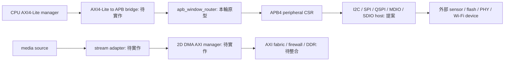

# 平台 bus／DMA／host 合約提案 v0.1

2026-11-01 15:00 Asia/Taipei。design proposed；只有 APB router 隔離原型新增 RTL。五種 host 未實作；不得由 target／VIP 名稱推定已具備。RFC：[issue #20](https://github.com/tonythetiger168/open-ip-portfolio/issues/20)。

## 責任與模組圖

現有 `*_apb` 是 APB4 CSR subordinate，protocol pins 原樣透傳；它既不是 AXI→APB bridge，也不把 I2C target／MDIO PHY／SDIO card 轉成 host。現有 `APB_top` 則為 APB3 memory completer，沒有 PSTRB；不可混為 APB4 decoder。

## APB router 已實作的受限合約

`rtl/platform/apb_window_router.sv`：一 requester、兩個 4KB page，預設 0x10000000／0x10001000，32-bit data、12-bit local byte address；4-byte alignment、PSTRB／PPROT 透傳。同一 PCLK/reset 域，組合路徑，零新增 pipeline cycles；目標 wait state 原樣傳回。setup 時下游 select 已有效，access 才允許完成；PSLVERR 僅在完成時回報。

未命中、misaligned 或 PAGE0=PAGE1 時一律不選任何 target，access 當周期 PREADY=1／PSLVERR=1／PRDATA=0；reset assertion 抑制 select/response。PCLK 不需接入此純組合模組，但上下游必須同域並在 APB setup/access 期間維持 attributes；本模組沒有 CDC 或 request snapshot。reset 在 access 中斷時由 CPU/bridge 重新開始，不承諾交易續傳。

不提供：多 requester 仲裁、timeout、權限 firewall、AXI bridge、動態 address remap、interrupt controller。PPROT 僅透傳，不當作可信 identity；安全 decoder 需在 trusted fabric 中另加 context/domain。若 target 永不 PREADY，本原型會持續等待，不可假造 timeout 完成後再向仍 busy 的 target 發新交易。最終產品必須決定 isolation/reset recovery。

獨立 bench 位於 open-vip-portfolio `ipcheck/platform/`；不是 portfolio APB_top 自我 loopback。16 directed checks、1 個 default-error mutant 被偵測、Yosys generic synthesis 完成。五項 coverage closure、CDC/RDC、formal、cell library、STA、板測均未完成；不增列成熟 catalog IP，不更新 generated wrappers/pages。

## 五種 host 的共用控制面（未實作）

候選命名 `platform_<protocol>_host`，與既有 `<PROTOCOL>_top` target 分開，絕不改其 ports。每 instance 4KB APB4 page、32-bit CSR、PSTRB、PSLVERR；CSR bus 在 PCLK 同域，pin timing 使用 clock-enable，避免以邏輯產生的 clock 當內部時鐘。跨域 FIFO／mailbox 需另做 CDC，不用逐 bit synchronizer 搬多 bit command。

|offset|CSR|合約|
|---|---|---|
|0x00/04|VERSION/CAP RO|版本、host role=1、可支援 mode/width、FIFO 深度；unsupported 組合須拒絕|
|0x08|CTRL WO|START／STOP_DRAIN／ABORT one-hot；busy 時 START 拒絕|
|0x0C|STATUS RO|idle/busy/draining/fault；不把 APB 寫入完成當線上交易成功|
|0x10/14|IRQ_STATUS W1C／ENABLE|done/error/rx-ready/tx-low；同周期 set 勝 clear，level IRQ|
|0x18/1C|ERROR_CODE／CLEAR|first error sticky；idle 才清，讀取無副作用|
|0x20/24|CLK_DIV／TIMEOUT shadow|單位 PCLK cycles，最小 divider 由 CAP 定義；timeout=0 禁用僅限 debug policy|
|0x28/2C|COMMAND／ADDRESS shadow|協定 operation、address；非法值在 START 前拒絕，無 pin side effect|
|0x30/34|LENGTH／MODE shadow|有效 payload bytes、mode；START 原子 snapshot，busy 更新僅影響下一筆|
|0x38/3C|TXDATA WO／RXDATA RO|候選 16-byte PIO FIFO，APB byte lanes 依 little-endian；under/overflow 回 PSLVERR，不能靜默遺失|
|0x40/44|TX_COUNT／RX_COUNT RO|FIFO bytes；不能透過讀 count 釋放資料|
|0x48/4C|DONE_SEQ／BYTES_DONE RO|一次 accepted command 對應一個終態，bytes 不含 command/address/CRC|
|0x50/54|CONTEXT／POLICY trusted|候選 privileged-only 設定；實際 domain 來自 trusted upstream，不能信任命令自稱 secure|

soft reset 只能在 idle 或系統隔離 ack 後；ABORT 不得撤銷已接受 DMA AXI。host PIO v0.1 尚無 descriptor DMA。若後續加 DMA，需接共用 frame/stream/memory contracts、cache maintenance、ring ownership、4KB split、outstanding drain，不能沿用 subordinate memory port 充當 manager。CSR base／頻率／pin 電壓／線速／吞吐／IRQ budget／PIO FIFO 深度均待 SKU 決策，數字只為候選。

error 類別：CFG_INVALID、NACK/NO_DEVICE、ARBITRATION_LOST、CRC、FRAME、TIMEOUT、FIFO、ABORTED、DOMAIN_DENIED。IRQ 通知不代表成功；每 command 用 seq+status+bytes 明確終態。reset 預設釋放共享 pins；boot flash write/erase 與 Wi-Fi firmware download 必須有 trusted policy/範圍限制，debug lock 由 security 工作整合。

## I2C host

角色：產生 SCL 與 START/STOP，SCL/SDA 使用 output-low + OE（只可 drive 0 或 release），含同步 input。候選 7-bit address、WRITE/READ／combined write→repeated START→read；phase1 不含 10-bit、HS、I3C。每 byte 驗 ACK，最後 read byte 由 host NACK 再 STOP。clock stretching 時等待實際 SCL high 才計 high period，分開 stretch timeout；arbitration lost 立刻 release，不產生破壞別人交易的 STOP。

ABORT 正常情況於 byte 邊界 STOP；arbitration lost 或外部 stuck-low 時 release + fault，不能宣稱已 STOP。bus recovery 最多 9 個可觀測 SCL pulse 後 STOP，必須由 trusted software 明確要求，不自動干擾其他 manager。驗收需獨立 target 的 address/data NACK、stretch、repeated START、read 最後 NACK、仲裁丟失、stuck SDA/SCL、abort 各 phase 與 reset release。

## SPI host

角色：輸出 SCLK/CSn/MOSI、輸入 MISO。候選 modes 0..3／MSB-first 8-bit、CS setup/hold 與 byte 間 CS keep；最小版若只做 mode0，CAP 必須如實限定。START snapshot CPOL/CPHA/divider，CS assert 前 SCLK 先達 idle，最後 bit sample/shift 邊緣完成才 deassert CS；MISO 不由 host 驅動。候選 CS 數量待定；拒絕同時選多 device。

TX underrun 不可靜默補 0，需預先收齊整 transaction 或在允許 pause 的 device profile 中停在安全 edge；ABORT 等完整 bit/byte 可觀測邊界，deassert CS、回 CPOL，回報部分 bytes。驗收四 mode edge 對齊／CS 間隔／多 byte keep／MISO sampling／FIFO underflow／busy 修改模式／reset CS inactive；既有 SPI target 僅可補充 interoperability，不是唯一 oracle。main 的 SPI MISO 未依 CS tri-state，PR #13 的修復尚未當作 main 能力。

## QSPI boot-flash host

獨立 command/address/dummy/data phase descriptor：opcode u8、address u32、address_bytes 3 或 4、dummy_cycles、每 phase lane width 1/4、data direction／length。候選先做 1-1-1 READ(03) 與明確 flash profile 的 fast/quad read；QE、4-byte mode、dummy count 依 flash datasheet，由 trusted boot policy 選 profile，不把 SPI target 的 quad mode 當 boot host。

IO0..3 使用獨立 OE；read turnaround 前 release，禁止 dummy phase 與 flash 爭用，WP#/HOLD# 預設狀態由板級決定。ABORT deassert CS 結束讀取，write/erase 已發命令則需 WIP polling 到安全狀態，不承諾 rollback。預設禁用 program/erase，需權限與範圍解鎖。

PIO boot read 不等於 XIP：XIP 還需 AXI read manager-facing subordinate、cache line fill、miss backpressure、execute permissions、flush/invalidate、boot remap 與 timeout isolation；本輪未實作。驗收獨立 flash model 的 JEDEC ID／03 read／boundary／dummy/lane/OE contention／4-byte address／reset/power failure；真實 flash/bootROM/secure boot 另驗。

## MDIO host

角色：輸出 MDC、MDIO output/OE/input；Clause22 frame 固定 32 個 preamble 1、ST01、OP01 write／10 read、PHYAD/REGAD 5 bit、TA、data16 MSB-first。read TA 第一 bit release、第二 bit必須讀到 0；全 1 不當有效 FFFF device response，需 NO_DEVICE。write TA=10。先保留全 preamble，Clause45 不支援，CAP 清楚標示。

MDC high/low、MDIO setup/sample 由 divider/timing profile 控制，實際線速與 oversampling/IO timing 待 PHY 選定。abort 完成目前 frame 後釋放，reset release MDIO/MDC idle；不可因 APB read 輪詢自動觸發新 MDIO frame。驗收獨立 PHY 對全部 PHYAD/REGAD 的讀寫／TA missing／無裝置／連續 transaction／abort／divider，下游現有 PHY target 地址0x0C 與 VIP model 地址5 不可直接視為一致。

## SDIO host

角色：輸出 SDCLK，CMD/DAT[3:0] 分離 OE/input/output；候選 1-bit identification→4-bit transfer、CMD0/5 OCR busy polling／CMD3 RCA／CMD7 select，透過 function0 CCCR 設 bus width／function enable／ready／interrupt，之後 CMD52 及 CMD53 byte/block、fixed/increment address。count=0 的協定語意按命令正確處理，不沿用現有 card 的 1..32 byte restriction 當產品需求。

response 類型、CRC7、每 DAT lane CRC16、busy/data-start timeout 分開；R4 無 CRC 類型不能強套 CRC7；DAT1 card IRQ 與資料時段需正確區分。identification 與 transfer clock、電壓切換／SDR modes／最大 block／function 數全部待模組選定，phase1 不支援 UHS/DDR/1.8V，自動 high-speed 禁用。

abort 需區分未發命令、response、data、busy；依 card command sequence 同步到可安全再送命令，timeout 未解決前 context fault，不自動 free DMA buffer。驗收獨立 card model 的 enumerate/function0/CCCR、CMD52 RAW、CMD53 byte/block/count0、CRC/timeout/busy/DAT1 IRQ、方向切換與 reset；現有 function1-only card 不能驗 enumerate，現有 VIP 固定 R1-style response 也不能驗 SDIO R4/R5/data host。

## Fabric／stream／DMA 的未完成合約

AXI memory fabric 必須分別處理 AW/W/B 與 AR/R、來源 ID 擴展、防 response misroute、每來源 outstanding、權限 aperture、decode error 與 QoS；W 不跨不同 AW 交錯，已 accepted requests 必須 drain。AXI-Lite bridge 必須獨立捕捉 AW/W，允許 W-first，APB 一次一筆；B/R stall payload 穩定；PSLVERR→SLVERR，unmapped→DECERR（候選 policy）。

媒體端點需 TKEEP/SOF/EOL、packing、backpressure；目前 AXI_Stream_top 沒有 TKEEP/TUSER，capture 滿後不能回收，不能當 frame DMA FIFO。2D DMA manager、frame ownership、secure domain、cache policy、4KB split、abort/drain 參考 ORCA draft PR #3，仍是提案，不能用它宣稱本 repo 已有 DMA。真實頻寬與 DDR 最大延遲未知，ETA 未知。
