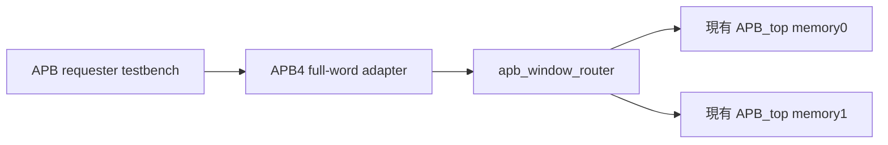

# 三產品整合用平台子系統基準 v0.1

2026-11-01。這是提供 integration 工作匯入的**平台子系統 fixture**，不是 TV／STB／IPCAM SoC top。中央 `verification/` 與產品 top-level hierarchy／全系統 filelist／地址／IRQ 配置仍由 integration 工作管理，本輪未寫該目錄，也未凍結產品層契約。

## 可建置邊界



fixture top：`platform_apb_slice`；filelist：`integration/platform/slice.f`（從 open-ip repo root 解析）。全部為 RTL，沒有 stub／TLM target。APB requester 是測試平台，不是 CPU RTL。原 `rtl/APB_top.sv` 未修改；它在基線 `be8c1755a4a16a05e4830c12366334792a1ba9fb` 的 blob 為 `5b55a2c5aa7331cf3c40a4c204aa88955d42fa85`。router 與新增 slice 的內容 SHA256／blob、filelist hash 與逐產品 profile 放 `integration/platform/baseline.json`。

|邊界|fixture 契約|產品 SoC 狀態|
|---|---|---|
|clock/reset|單 pclk；bench 10ns period 僅為模擬假設；rst_n 低有效，APB_top 非同步 assert；bench 負緣 deassert|實際 clock tree／reset controller／CDC/RDC 待 integration|
|requester|APB4 32-bit data/address、PSTRB、PPROT|CPU／AXI-Lite→APB bridge 未接入，BLOCKED|
|memory0|0x10000000..0x10000FFF|產品地址僅供候選，未獲 SoC memory map 核准|
|memory1|0x10001000..0x10001FFF|同上；兩個 target 的有效 memory 各 256×32 bits|
|target local decode|0x000..3FF fast；0x400..7FF 為同一 memory alias 且多一 wait；0x800..FFF error|不是所有 4KB bytes 都是可用 RAM，也不是 DDR|
|APB4→APB3|只有完整 word write (PSTRB=F) 合法；其他 write 含 PSTRB=0 均拒絕，無 target select；read 忽略 PSTRB|這是受限 adapter policy，不宣稱完整 byte-write peripheral bridge|
|IRQ|irq[0/1] 是各 target PSLVERR 完成事件，非 sticky IRQ controller；hole/misaligned/partial rejection 沒有 target IRQ|IRQ mapping／PLIC／driver 未接，BLOCKED|
|PPROT/security|router 透傳，APB3 target 不消費；不能用此 fixture 證明安全隔離|trusted context、firewall/IOMMU 尚未整合，BLOCKED|
|frame／stream／DMA|本 fixture 無此 ports／RTL|沒有 frame ownership、QoS、drain 整合結果，BLOCKED|

adapter 不把 PSTRB 靜默丟棄；partial-write error 於 access 完成，PRDATA=0、PREADY=1、PSLVERR=1。reset 取消當前 fixture request，upstream 需重新 setup；沒有保證 reset 交易續傳。bench 只做 quiescent reset，中途 reset/drain 尚待 campaign。

## 三產品 profile 邊界

TV／STB／IPCAM 的 `apb-memory-fixture-v1` 使用相同 RTL，只以產品 label 分開儲存 run；**不是三種 SKU 功能整合**，不代表 decoder／encoder／ISP／display／DDR／PHY 已接好。`baseline.json` 逐產品列 `full_soc_elaboration=BLOCKED`；不得拿共用 fixture 通過取代任一產品 SoC elaboration gate。integration 匯入時必須提供實際 product/config hierarchy/filelist、完整 source pins 與 dependency 清單。

## 實際 gate 與限制

在 paired open-vip 分支執行：

```sh
python3 ipcheck/platform/run_slice.py --ip-dir ../open-ip-portfolio --evidence-dir reports/platform_slice
```

Icarus 12.0 elaboration 成功；三個產品 label × seeds 1/7/42 各 209 transactions，逐 run 739／741／739 個 checks 通過；總計 1881 transactions，不含 seed7 額外 replay。TV seed7 replay log 完全相同。移除 partial-write rejection 的 mutant 被 response checker 與 memory scoreboard 抓到。Verilator 5.032 對三個 RTL 模組 lint exit0。工具／source hashes／run logs 在 paired VIP `reports/platform_slice/`，本repo保留結果副本。

最初 runner 非空檢查門檻誤設為 800，RTL log 當時已有 739 個成功 checks；本輪改為每 transaction 至少 3 個必要檢查後重跑。最終程式／結果才列 gate 通過，未把先前 runner failure 記作成功。

這是 procedural constrained campaign harness，**尚未執行 UVM**。六類 coverage raw DB 均未產出；FSM state/arc、SVA nonvacuous witnesses、covergroups 仍需工具／instrumentation。沒有新增 slice 的 generic synthesis、STA、physical PPA 或板測；前一輪 router-only synthesis 不能外推到此 fixture。

## 交給 integration 的 gate

1. 先按 `baseline.json` 核對三個 RTL source hashes／filelist 與同域 ports，匯入實際 hierarchy 時重建 fingerprint。
2. product full top 的缺 IP／stub／TLM 每項列 BLOCKED；不可把此 fixture 名稱改成 SoC completed。
3. shared UVM contract 由 paired VIP `docs/design/platform_shared_uvm_plan.md` 提供；平台 subordinate memory model 不等於 DDR controller。
4. 最終六類 100% 必須逐 product/config/scope 關閉；未量測／工具不支援不列 waiver；ETA 未知。
